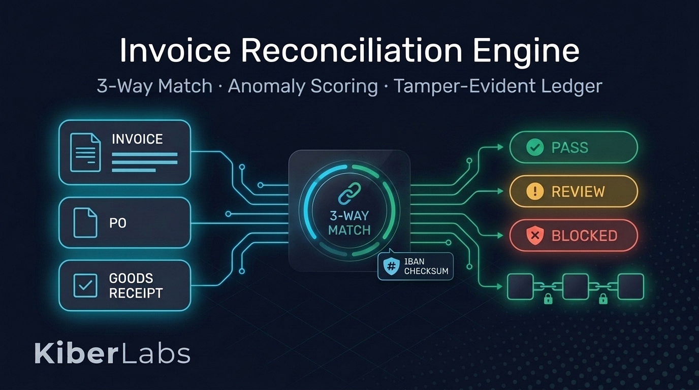
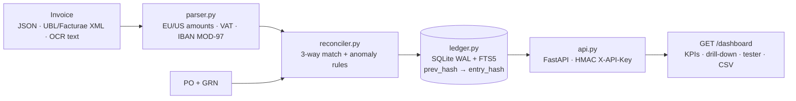

# KiberLabs — B2B Invoice Reconciliation Engine

[](https://github.com/Kiberlabs/b2b-invoice-reconciliation-engine/actions/workflows/ci.yml)



Deterministic **accounts-payable control** for B2B teams: parse invoices from **JSON, UBL / Facturae-style XML and noisy OCR text**, run a **3-way match (Invoice ↔ Purchase Order ↔ Goods Receipt)**, score fraud/error risk **0–100** with explicit `PASS` / `REVIEW` / `BLOCKED` verdicts, and keep every decision in a **tamper-evident SQLite ledger** (SHA-256 hash chain). Zero paid LLM SDKs, zero network calls: the same input always gives the same verdict, which is what auditors need.

---

## Architecture



## Anomaly rules

| Code | Points | Forces BLOCKED |
|---|---|---|
| `DUPLICATE_INVOICE_NUMBER` (same vendor) | 60 | yes |
| `INVALID_IBAN` (ISO 13616 MOD-97 / length) | 50 | yes |
| `UNAPPROVED_VENDOR` | 45 | yes |
| `ARITHMETIC_ERROR` (subtotal + tax ≠ total) | 40 | no |
| `NEAR_DUPLICATE` (same vendor + amount within 7 days) | 35 | no |
| `NO_PO`, `VENDOR_PO_MISMATCH`, `QTY_OVER_RECEIVED` | 30 | no |
| `PRICE_VARIANCE` (> 3% vs PO), `QTY_OVER_PO`, `SKU_NOT_IN_PO` | 25 | no |
| `MISSING_GRN`, `LINE_SUM_MISMATCH` | 20 | no |
| `INVALID_VAT` (format) | 15 | no |

Score = `min(100, sum of points)`. Verdict: `BLOCKED` if any critical rule fired or score ≥ 70; `REVIEW` if any other anomaly fired; otherwise `PASS`.

## Tamper-evident ledger

Each audit row stores `prev_hash` and `entry_hash = SHA-256(prev_hash | canonical row JSON)`. `verify_chain_integrity()` recomputes the chain from genesis and returns the first broken sequence number, so edited, deleted or reordered rows are detected. Truncating the *tail* is only detectable if you pin `head_hash()` outside the database and pass it as `expected_head`.

Storage: `PRAGMA journal_mode=WAL`, `busy_timeout=5000`, `BEGIN IMMEDIATE` appends (safe with concurrent writers), FTS5 search over invoice / vendor / verdict / anomaly codes.

## Quickstart

```bash
pip install -e ".[dev]"
pytest -v

export INVOICE_ENGINE_API_KEY="$(python -c 'import secrets;print(secrets.token_urlsafe(32))')"
uvicorn invoice_engine.api:create_app --factory --port 8000
# open http://127.0.0.1:8000/dashboard and paste the key
```

```bash
curl -s -X POST localhost:8000/v1/reconcile -H "X-API-Key: $INVOICE_ENGINE_API_KEY" -H "Content-Type: application/json" -d '{
  "invoice": "Invoice No: INV-9\nVAT: ESB12345674\nIBAN: ES91 2100 0418 4502 0005 1332\nDate: 2026-11-20\nPO: PO-1\nCMP-1 Board 10 x 25,00\nSubtotal: 250,00\nIVA 21%: 52,50\nTotal: 302,50 EUR",
  "format": "text",
  "po":  {"po_number": "PO-1", "vendor_vat": "ESB12345674", "lines": [{"sku": "CMP-1", "quantity": 10, "unit_price": "25.00"}]},
  "grn": {"po_number": "PO-1", "lines": [{"sku": "CMP-1", "quantity": 10}]}
}'
```

| Endpoint | Auth | Purpose |
|---|---|---|
| `GET /health` | none | liveness |
| `GET /dashboard` | none (data calls need the key) | dark-mode executive dashboard |
| `POST /v1/reconcile` | `X-API-Key` | parse → match → score → append to ledger |
| `GET /v1/ledger?q=&limit=` | `X-API-Key` | audit rows, FTS5 search |
| `GET /v1/ledger/verify` | `X-API-Key` | hash-chain integrity report |
| `GET /v1/export.csv` | `X-API-Key` | audit export (spreadsheet-formula safe) |

Keys are compared with `hmac.compare_digest` on SHA-256 digests. The app **refuses to start** without `INVOICE_ENGINE_API_KEY`. Approved vendors: `INVOICE_ENGINE_APPROVED_VENDORS` (comma-separated VAT ids; demo defaults are synthetic).

## Docker

```bash
docker build -t invoice-engine .
docker run -p 8000:8000 -e INVOICE_ENGINE_API_KEY=change-me -v invoice-data:/app/data invoice-engine
```

Multi-stage build, runs as non-root `appuser`, with an HTTP `/health` check.

## Known limits

- VAT validation is **format-only** (no VIES lookup, no per-country checksum).
- `2.500` with a single separator and three digits is read as 2500 (EU thousands); send JSON numbers when that is ambiguous.
- OCR parser expects `SKU  description  qty x unit-price` lines and common English/Spanish labels; the fixtures are synthetic.

MIT · Built by KiberLabs Engineering.
